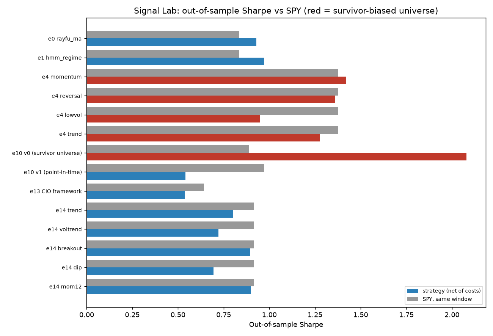
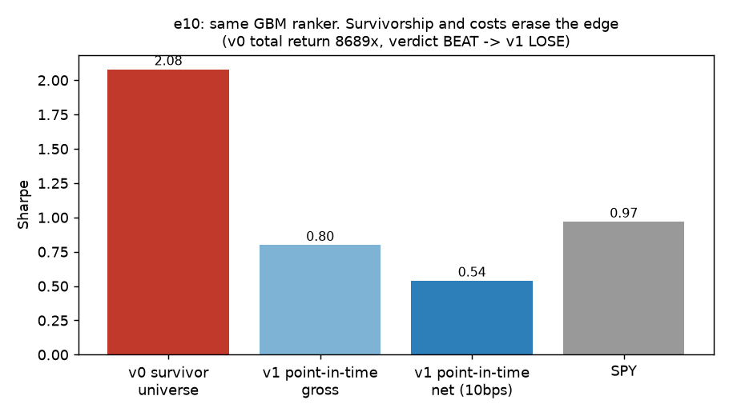

# Signal Lab

[](https://github.com/aidankaras/signal-lab/actions/workflows/ci.yml)
[](LICENSE)
[](pyproject.toml)



A walk-forward backtesting harness for evaluating trading strategies against the S&P 500
under strict anti-overfitting controls. Every experiment is pre-registered, scored on the
identical window against buy-and-hold and a random-entry control, and published with its
verdict — failures included.

## Why

Most published strategy results — especially those from retail "AI trading bot" posts —
do not survive out-of-sample testing with realistic costs. This lab exists to run those
claims through an honest evaluation pipeline and record what happens. ~20 strategy
classes have been tested (e00–e19; e11 and e15 were never run): every concluded
experiment loses to SPY out-of-sample after costs; e16b/e17 are live forward tests
(verdict ~mid-Jan 2027), e18 is running, e03/e05 are on their paper clocks. The
negative results are the product: the harness, the controls, and the discipline of
publishing verdicts that do not flatter the work.

## Results

| Experiment | Claim tested | Verdict |
|---|---|---|
| [e00](experiments/e00-ma-baseline/) | MA-crossover baseline (benchmark, not a claim) | informational |
| [e01](experiments/e01-hmm-regime/) | HMM regime detection | LOSE |
| [e02](experiments/e02-insider-filings/) | Insider Form-4 filing clusters predict returns | LOSE — AUC 0.498 vs 0.55 kill gate; e2 v2 (cluster events): **LOSE** — mean −1.53%, t −2.30, n=120, 2011–2017 window |
| [e03](experiments/e03-kalshi-logger/) | Kalshi maker-spread paper logger | running — 4-week paper clock to ~2026-11-15 |
| [e04](experiments/e04-factor-tilts/) | Classic factor tilts (momentum, low-vol, reversal, trend) | LOSE — no factor passes both regime splits |
| [e05](experiments/e05-thesis-book/) | Thesis-research 10-position paper book vs SPY, QTUM and random-pick control | PENDING — seeded 2026-10-20, demote rule at 2 quarters |
| [e06](experiments/e06-sec-filings/) | SEC-filing features forecast 5-session abnormal returns | LOSE — IC 0.017, t 0.11 |
| [e07](experiments/e07-daytrading-setups/) | Claimed day-trading setups (ORB, VWAP reclaim/fade, gap-and-go) | reclaim/fade LOSE at random-entry control; ORB SUSPECT |
| [e08](experiments/e08-lstm/) | LSTM on daily price sequences | LOSE — IC −0.0082 (anti-predictive) |
| [e09](experiments/e09-local-llm/) | Local 1.5B LLM analyst (zero-shot, llama.cpp) | LOSE — constant-UP predictor, accuracy = base rate |
| [e10 v1](experiments/e10-gbm-ranker/) | Same GBM on point-in-time S&P 500 membership, 10bps/side | **LOSE** — net Sharpe 0.54 vs SPY 0.97, CAGR 10.5% vs 15.4%; beats random-pick p95 (0.42) only; IC t 1.98 |
| [e10 v0](experiments/e10-gbm-ranker/) | GBM cross-sectional ranker (momentum + price features) | gate passed, SUSPECT — survivorship-biased universe; not promoted |
| [e12](experiments/e12-pairs-cointegration/) | Pairs trading via cointegration (780-pair scan) | LOSE — real pairs underperform a random-pairs control |
| [e13](experiments/e13-cio-framework/) | "CIO framework" LLM prompt, decomposed | LOSE — Sharpe 0.54 vs SPY 0.64 |
| [e14](experiments/e14-thirdparty-etf-rules/) | Shared bot: 5 rules (trend, vol-trend, breakout, dip, 12m momentum) on 7 ETFs/crypto | LOSE — 0/5 pass own gate (v0 and v1 with the shared params); none beats SPY |
| [e16a](experiments/e16-daily-direction/) | Daily SPY open->close direction: logit + HGB walk-forward, 20 bps/round trip, TP/SL overlays | **LOSE** — 0/4 variants pass; AUC 0.495 (logit) / 0.520 (HGB); net Sharpe −1.6 to −3.5 vs SPY B&H 0.86; always-long intraday gross 0.43 |
| [e16b/e17](forward/SPEC-e16b-e17.md) | Live forward arms of e16/e17 on paper accounts | running — verdict ~mid-Jan 2027 |
| [e18](experiments/e18-newtoken-logger/) | New crypto token listing logger + scorer | running |
| [e19](experiments/e19-foundation-forecast/) | Zero-shot Kronos / TimesFM forecasts on 14 ETFs | **LOSE** — 0/12 trials BEAT (Bonferroni alpha 0.0042) |

Each experiment folder is self-contained — runner code, report, and `SPEC.md`
(the pre-registration written before the run).

Two documented artifacts worth reading the code for: e10 shows how a naive GBM
replication prints ~87%/yr when the universe is today's mega-caps (survivorship), and
e7's first run scored every short exit as a fake win because the simulator was
long-only — both are flagged in the reports rather than hidden.

## Key findings

- **Survivorship bias manufactures edge.** The same GBM ranker prints Sharpe 2.08 and an 8,689x
  total return on today's mega-caps (e10 v0, verdict BEAT). On point-in-time S&P 500 membership
  it is net Sharpe 0.54 vs SPY 0.97 and **LOSE** (e10 v1).
- **Costs and turnover eat gross edge.** e10 v1 gross Sharpe 0.80 falls to 0.54 net at 10 bps/side
  (0.63 turnover per rebalance). Daily-direction models on SPY (e16a, on branch `exp/e16-daily-direction`)
  show the extreme case: 20 bps round trip turns a gross 0.43 into net Sharpe −1.6 to −3.5.
- **Random controls matter.** On a survivor-biased universe 16 of 20 random 3-stock picks beat
  SPY, so beating SPY is not evidence; verdicts require beating the random-pick median and
  equal-weight universe too. e12's real cointegrated pairs underperform random pairs.
- **Negative results are the output.** LSTM IC is anti-predictive (−0.0082), the local LLM is a
  constant-UP predictor, insider clusters score AUC 0.498 vs a 0.55 gate.



## Limitations

- Free data only (yfinance adjusted closes); no delisted-name prices, so even the point-in-time
  e10 v1 covers 68%–99% of historical members depending on date (lowest early; delisted names are missing).
- Most universes are small (BROAD-40, 7 ETFs); single-stock results are flagged SUSPECT.
- Intraday tests (e07) cover ~60 days of 5-minute data; e06 has 17 scored days. Low power.
- Costs are flat bps assumptions, no market impact or borrow costs; fills at next-bar open.
- SPY is the S&P 500 proxy. Holdouts are re-used once per generation, so they degrade;
  generations are capped but not zero-cost.
- Seeds, universes and windows differ across experiments: compare verdicts, not raw numbers.
- No live-trading evidence; e03 and e05 are paper clocks that have not matured.

## Design

- **No lookahead.** Signals are computed from data available at decision time; fills at
  the next bar's open; labels embargoed across walk-forward blocks. Stop/target checks
  are conservative within each bar.
- **Costs in every test.** 5 bps per side plus slippage, charged in a causal simulator.
- **Controls on every claim.** Random-entry (same rule, random timing) and random-pair
  (same rule, random selection) controls run alongside every strategy.
- **Overfit accounting.** `registry/trials.jsonl` is append-only and records every trial;
  Deflated Sharpe/PBO are computed over the full count, so retrying an idea until it
  looks good cannot fake an edge.
- **Same-window comparison.** Every verdict is strategy vs SPY vs control over
  identical dates.
- **Pre-registration.** Grids, gates and kill criteria are written into each experiment's
  `SPEC.md` and `registry/experiments.yaml` before any run; the registry shows kill
  criteria being honored (e2, e8, e9, e12 lanes closed after first losing generation).

## Stack

Python 3.14 · pandas · NumPy · SciPy · scikit-learn · PyTorch (CPU) · llama.cpp ·
yfinance · SEC EDGAR APIs. Heavy runs execute on a dedicated compute box;
scheduled research jobs run as cron tasks. The LLM-analyst experiment ran a
Qwen2.5-1.5B GGUF locally through llama.cpp.

## Layout

```
harness/       data fetch, causal simulator, evaluator (IC/Sharpe/verdict), verdict gates
experiments/   one folder per experiment: runner, report, SPEC.md, README.md
registry/      experiments.yaml (pre-registered grids/gates), trials.jsonl (append-only)
harness/strategies/  legacy strategy classes shared by the harness (MA, HMM, factors, random control)
tests/         pytest unit tests (synthetic data) + tests/smoke.py (needs market data)
docs/          METHODOLOGY.md, ROADMAP.md, chart script and images
```

## Quickstart (fresh clone)

```bash
git clone https://github.com/aidankaras/signal-lab-public.git && cd signal-lab-public
python -m venv .venv && source .venv/bin/activate
pip install -r requirements.txt
python -m pytest -q                       # unit tests, synthetic data, no network
python docs/make_charts.py /tmp/charts    # regenerates the e10 v0->v1 chart from the committed JSON
```

Reproduce one result from raw data (needs network; downloads prices via yfinance):

```bash
python experiments/e12-pairs-cointegration/run_e12.py   # pairs walk-forward, compare with e12-pairs.md
python -m tests.smoke                                   # e0/e1/control causality + verdict on real data
```

## Operating rules

Paper trading only until an experiment clears its pre-registered gate and the owner
approves live testing. Capital caps: $100 lifetime real loss, $275 per 90 days.
Permanently excluded: on-chain "bot contracts", taker-only strategies, paid data
subscriptions, copy-trading of public officials' filings.

## Related work

- [tonbistudio/model-trader](https://github.com/tonbistudio/model-trader) — model-based
  trading framework; shares the harness-first mindset but does not publish out-of-sample
  verdicts or a random-control baseline, which is this lab's main addition.
- [aidankaras/sec-filings-e6](https://github.com/aidankaras/sec-filings-e6) — companion
  repo for the SEC-filing data pipeline behind [e06](experiments/e06-sec-filings/).

## License

MIT — see [LICENSE](LICENSE).
