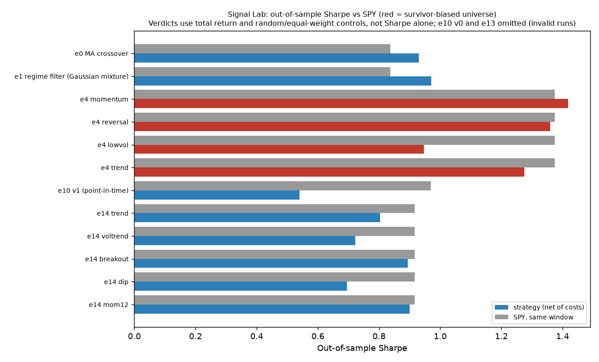
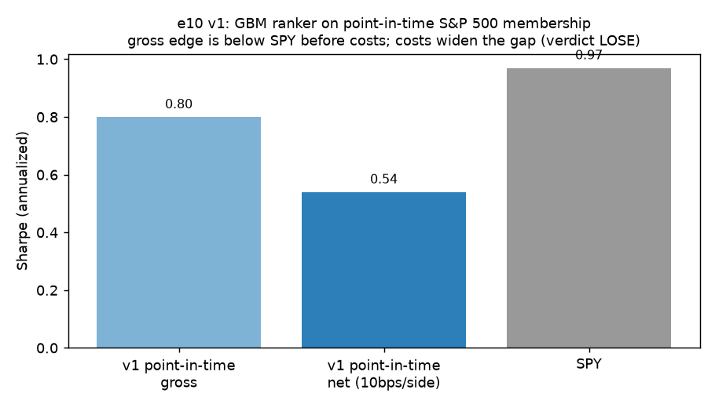

# Signal Lab

[](https://github.com/aidankaras/signal-lab-public/actions/workflows/ci.yml)
[](LICENSE)
[](pyproject.toml)



A walk-forward backtesting harness for evaluating trading strategies against the S&P 500
with anti-overfitting controls: pre-registration, random-entry controls, same-window comparison
against buy-and-hold, and an append-only trial log. Results are published with their verdict,
failures included. The repository was archived in November 2026; the errata below were added at
that point.

## Why

Most published strategy results, especially retail "AI trading bot" posts, do not survive
out-of-sample testing with realistic costs. This lab ran such claims through one evaluation
pipeline and recorded what happened. Twenty experiments are indexed below (e00–e22; e11, e15 and
e21 were never run). None of the valid results shows a usable edge: they lose to SPY (equity
strategies) or to random-entry and trend-following controls (FX), and the few that pass a gate
do so on a survivor-biased universe and are not promoted. Several published verdicts turned out
to rest on bugs; they are listed in the errata and relabeled rather than removed. Of the five
runs marked INVALID, three were re-run with the fixed code in November 2026: e07 ORB/fade and e12
now LOSE, and e10 v0 passes its gate narrowly on a survivor-biased universe (SUSPECT, not
promoted). e09 and e13 are still INVALID and await a re-run.

## Errata (November 2026)

A line-by-line review of the runners found bugs under several published verdicts. Each one is
fixed in code. Market data could not be downloaded when the fixes were made, so the affected
experiments were first relabeled INVALID or "pending re-run" with numbers recomputed from committed
files; anything marked "rough" is arithmetic on committed summary numbers, not a re-run. On
2026-11-25 the fixed runners for e07, e10 v0 and e12 were re-run once on fresh data with their
pre-registered parameters; those rows now give the re-run result (files named `*-rerun-2026-11.*`,
trials appended to `registry/trials.jsonl`). The old reports stay in the repo, marked INVALID.

| Experiment | What was wrong | What changes | Does the conclusion hold? |
|---|---|---|---|
| e10 v0 | The top decile's 5-day forward return was recorded every day, compounded daily and annualized with sqrt(252), so each day counted about 5 times. Returns were abnormal (vs SPY) but compared with SPY's total return; pre-cost; IC t ignored the overlap. | v0 is INVALID. Rough correction: Sharpe ~2.08/sqrt(5) = 0.93, IC t ~2.07, the 8,689x total is about 14.7%/yr pre-cost abnormal return. The "8,689x / 87%/yr from survivorship" story is withdrawn. Runner fixed (5-session rebalances, costs, Newey-West t). | e10 v1 (point-in-time, LOSE) is not affected. **Re-run (2026-11-25):** IC 0.010, Newey-West t 2.03, top-decile net Sharpe 1.07 vs SPY 0.97 at 5 bps/side (2012-07 to 2026-11). Passes the gate narrowly on survivor-biased BROAD-40: SUSPECT, not promoted. A first attempt that lost META to a failed download gave t 2.04, Sharpe 0.89, LOSE; both trials are logged. |
| e04 | The README said "no factor passes both regime splits". The repo's own reports show reversal and trend PASS the strict gate on both splits (momentum on 2023+ only). | Relabeled SUSPECT, not promoted. | Still not an edge: survivor-biased BROAD-40, champion parameters differ between splits, and champions were promoted on the same holdout they are scored on. |
| e09 | The output parser looked for "ANSWER:", which the prompt never contained; llama-cli echoes the prompt ("UP or DOWN"), so every call parsed as UP. | "Constant-UP predictor" withdrawn; e09 is INVALID. Parser fixed (prompt not echoed, grammar-constrained UP/DOWN). | Unknown. Pending re-run (needs a local llama.cpp build and the GGUF model, which were not available for the November re-runs). |
| e07 ORB | The short leg was simulated as a long; the stop check fired on the first bar and booked every short as a win. That is the +0.519%/trade and 68.6% win rate. e7c (fade) always shorted, even below VWAP. | ORB INVALID (it was labeled SUSPECT; the trial log says BEAT). Both fixed. | **Re-run (2026-11-25), LOSE:** ORB -0.133%/trade (n 2,248), fade -0.111% (n 221), reclaim -0.145% (n 736), random entries -0.165%, after 14 bps round trip. Only ~60 days of 5-minute bars are available (2026-09-02 to 2026-11-25), a different window from the first run. |
| e12 | The position was updated from today's z-score before today's spread change was booked, so entries booked their trigger move as a loss and exits dropped the reversion; a perfect +3 to 0 reversion scored about -6%. Also double-scaled P&L, ADF instead of Engle-Granger critical values, random pairs with hedge ratio 1, late listings dropped. | INVALID. "Real cointegrated pairs underperform random pairs" is withdrawn. Runner fixed (and, at the re-run, a leftover global drop of late listings removed). | **Re-run (2026-11-25), LOSE:** mean annual -2.9% over 2016–2026 vs SPY +15.0%; random pairs -3.8%. Selection adds about a point a year over chance, well inside the noise. |
| e13 | `harness.data.fetch` returned the cached 8-ticker e0 panel instead of BROAD-40, so most picks earned 0%. Also: book only 50% invested, no switch to SPY when risk-off, same-bar look-ahead, ROA used as ROE, control never rebalanced. | INVALID. Cache check added to the harness; runner fixed. | Unknown. Pending re-run: SEC EDGAR refuses requests without a real contact in the `User-Agent`, and the runner ships with a placeholder. |
| e20 | 4H bars are labeled by their start; the scan began at the start of the break candle, so about 30% of trades (54% of the no-trigger ablation) entered before that candle closed. | Dropping those trades from the committed CSVs: primary holdout -0.12R (t -0.72, n 111) instead of -0.04R; every variant is lower. Runner fixed. | LOSE holds (the leak favored the strategy). The dev-period ablation and the 2003–14 / 2022+ follow-up ran on the leaky code and are tainted. Not re-run yet: the free Dukascopy feed throttled the hourly-candle download to about one month-file per minute (about 1,400 files needed), and the follow-up's runner is not in this repo. |
| e08 | IC t-stat treated overlapping 5-day labels as independent; early stopping held out the last ~10 tickers (rows were sorted by ticker), sharing dates with training. | Rough overlap correction puts t = -2.06 near -0.9. "Anti-predictive" withdrawn. Runner fixed. | LOSE (no skill) holds. |
| e06 | Entry at the filing-date close (Form 4s are often filed after the close); 5-day embargo where 10 was pre-registered; t-stat ignored overlap. | Runner fixed. | LOSE very likely holds (IC 0.017, t 0.11 over 17 days). Pending re-run. |
| e02 v0 | Filings were counted over a Monday–Sunday week, but entry used the close on or before that Monday (up to ~6 days early). | Runner fixed (entry at the next Monday's close). | v0 AUC 0.498 pending re-run. v1/v2 are not affected. |
| e16a | 20 bps per round trip is far above SPY's real cost and produces the -1.6 to -3.5 net Sharpe. | Cost table added (1–20 bps). At 2 bps the variants are 0.06 to 0.42 net. | LOSE holds: nothing beats SPY buy-and-hold (0.86) even at 1 bp, and no model passes the AUC gate. |
| Harness `evaluate()` | BEAT was `(1 + s - b).prod() > 1`, not a comparison of total returns; a +27.8% strategy lost to a +27.0% benchmark. | Fixed and unit-tested. In the committed JSON two intermediate entries would flip (e4 reversal gen 0; regime-check low-vol gen 1–2). | No final verdict changes. |
| Fills | Docs said fills happen at the next bar's open. The harness fills at the signal bar's close (weights decided at close *t* earn close *t* to *t+1*). | Docs corrected. | Common practice; no verdict changes. |
| Quickstart | Runners wrote to a missing `reports/` folder and crashed after appending to `registry/trials.jsonl`; `make_charts.py` needed matplotlib, which was not in `requirements.txt`. | Fixed: folders are created first, trials are logged after outputs; matplotlib added. | n/a |

Re-run commands (need network and, for some, local data or a local model) are listed in each
experiment's folder; the main ones are under [Quickstart](#quickstart-fresh-clone).

## Results

| Experiment | Claim tested | Verdict |
|---|---|---|
| [e00](experiments/e00-ma-baseline/) | MA-crossover baseline (benchmark, not a claim) | informational (trails SPY on total return) |
| [e01](experiments/e01-hmm-regime/) | Volatility-regime filter (Gaussian mixture; filed as "HMM") | LOSE |
| [e02](experiments/e02-insider-filings/) | Insider Form-4 filing clusters predict returns | v0: LOSE, AUC 0.498 vs 0.55 kill gate (pending re-run, see errata); v2 cluster events: **LOSE** — mean −1.53%, t −2.30, n=120, 2011–2017 |
| [e03](experiments/e03-kalshi-logger/) | Kalshi maker-spread paper logger | discontinued at archive (2 days of quotes, no verdict) |
| [e04](experiments/e04-factor-tilts/) | Classic factor tilts (momentum, low-vol, reversal, trend) | SUSPECT, not promoted — reversal and trend pass the strict gate on both splits, on a survivor-biased universe with holdout-selected champions |
| [e05](experiments/e05-thesis-book/) | Thesis-research 10-position paper book vs SPY, QTUM and random-pick control | discontinued at archive (seeded 2026-10-20, only the day-0 snapshot exists) |
| [e06](experiments/e06-sec-filings/) | SEC-filing features forecast 5-session abnormal returns | LOSE — IC 0.017, t 0.11, 17 scored days (runner fixed, see errata) |
| [e07](experiments/e07-daytrading-setups/) | Claimed day-trading setups (ORB, VWAP reclaim/fade, gap-and-go) | **LOSE** — re-run on 60 sessions of 5-min bars, 14 bps round trip: ORB −0.133%/trade (n 2,248), fade −0.111% (n 221), reclaim −0.145% (n 736) vs random entries −0.165%; gap-and-go 4 trades, untestable |
| [e08](experiments/e08-lstm/) | LSTM on daily price sequences | LOSE — no skill (IC −0.0082; overlap-corrected t about −0.9) |
| [e09](experiments/e09-local-llm/) | Local 1.5B LLM analyst (zero-shot, llama.cpp) | INVALID — output-parser bug; pending re-run |
| [e10 v1](experiments/e10-gbm-ranker/) | Same GBM on point-in-time S&P 500 membership, 10bps/side | **LOSE** — net Sharpe 0.54 vs SPY 0.97, CAGR 10.5% vs 15.4%; beats random-pick p95 (0.42) only; IC t 1.98 |
| [e10 v0](experiments/e10-gbm-ranker/) | GBM cross-sectional ranker on BROAD-40 (today's large caps) | SUSPECT, not promoted — re-run: IC t 2.03, net Sharpe 1.07 vs SPY 0.97 at 5 bps/side; passes the gate narrowly on a survivor-biased universe, and an attempt missing META (failed download) did not pass (the first run was INVALID) |
| [e12](experiments/e12-pairs-cointegration/) | Pairs trading via cointegration | **LOSE** — re-run: mean annual −2.9% (2016–2026) vs SPY +15.0%; random pairs −3.8% (the first run was INVALID) |
| [e13](experiments/e13-cio-framework/) | "CIO framework" LLM prompt, decomposed | INVALID — ran on the wrong price data; pending re-run (needs SEC EDGAR access with a real contact) |
| [e14](experiments/e14-thirdparty-etf-rules/) | Shared bot: 5 rules (trend, vol-trend, breakout, dip, 12m momentum) on 7 ETFs/crypto | LOSE — 0/5 pass own gate (v0 and v1 with the shared params); none beats SPY |
| [e16a](experiments/e16-daily-direction/) | Daily SPY open->close direction: logit + HGB walk-forward, TP/SL overlays | **LOSE** — 0/4 variants pass; AUC 0.495 (logit) / 0.520 (HGB); net Sharpe 0.06–0.42 at 2 bps, −1.6 to −3.5 at the pre-registered 20 bps, vs SPY B&H 0.86 |
| [e16b/e17](forward/SPEC-e16b-e17.md) | Live forward arms of e16/e17 on paper accounts | discontinued at archive (no scored calls committed) |
| [e18](experiments/e18-newtoken-logger/) | New crypto token listing logger + scorer | discontinued at archive (1 day of data, gate needs ≥200 approved tokens) |
| [e19](experiments/e19-foundation-forecast/) | Zero-shot Kronos / TimesFM forecasts on 14 ETFs | **LOSE** — 0/12 trials BEAT (Bonferroni alpha 0.0042) |
| [e20](experiments/e20-fx-break-retest/) | Retail FX "break → retest → engulfing" setup, 10 pairs, 2015–2026 | **LOSE** — holdout (2022+) mean −0.04R/trade, t −0.29, n=152 (−0.12R without the look-ahead trades); 0/6 variants reach t≥2. The follow-up on the best dev ablation also failed but ran on the leaky code; corrected re-run pending (data feed throttled); FX lane closed |
| [e22](experiments/e22-tsmom/) | Cross-asset vol-targeted 12-1 time-series momentum, 8 ETFs, 2015+ holdout | **LOSE** — best holdout Sharpe 0.52 (long-only) vs SPY 0.80; long/short variants ≈ 0 |

Verdict labels: **BEAT** (passes every pre-registered gate), **LOSE** (fails at least one),
*informational* (benchmark, no claim), SUSPECT (passes a gate but the universe/sample is not
trustworthy, so not promoted), INVALID (the run had a bug that decides the result; fixed in code,
not yet re-run), discontinued (forward test stopped at archive, no verdict).
Verdicts use total return and controls; Sharpe alone does not decide them, which is why some
LOSE rows in the chart above show a Sharpe higher than SPY's.

Each experiment folder holds its runner code and report, and a `SPEC*.md` pre-registration where
one exists (e0, e1, e2 v0, e3 and e4 have none; see each folder's README).

## Key findings

These are the conclusions that survive the errata.

- **Survivorship and costs.** On point-in-time S&P 500 membership the GBM ranker is net Sharpe
  0.54 vs SPY 0.97 and **LOSE** (e10 v1); gross Sharpe 0.80 falls to 0.54 net at 10 bps/side
  (0.63 turnover per rebalance). The earlier "8,689x on today's mega-caps" figure was mostly a
  return-math error and is withdrawn. Re-run correctly on today's mega-caps (e10 v0), the same
  model is net Sharpe 1.07 vs SPY 0.97 with IC t 2.03: a bare pass on a survivor-biased list that
  disappears on point-in-time membership.
- **Random controls matter.** On a survivor-biased universe most random 3-stock picks beat SPY
  (16 of 20 seeds in the e0 report), so beating SPY is not evidence; the strict verdict also
  requires beating the random-pick median and the equal-weight universe. The e4 factor tilts
  that do pass that bar are still SUSPECT for the reasons in the errata.
- **Costs decide daily strategies.** e16a's daily SPY direction models have no skill (AUC 0.495 /
  0.520). Whether they lose a little or a lot depends on the cost assumption; they lose at every
  cost level tested.
- **Trend momentum faded.** Classic vol-targeted 12-1 time-series momentum has dev Sharpe 0.60
  (t 2.59) but ≈0 after 2014; best holdout Sharpe 0.52 vs SPY 0.80 (e22).
- **Bugs hide in the plumbing, not the model.** Five published verdicts were decided by P&L,
  timing, data-loading or parsing bugs (e07 ORB, e09, e10 v0, e12, e13), and e20's development
  numbers were inflated by look-ahead inside a bar. Most of these runners did their own
  simulation instead of using the unit-tested harness code. Re-run with the fixes, the e07 ORB
  "edge" (+0.519%/trade) became a loss (−0.133%/trade), and e12's cointegrated pairs now lose
  slightly less than random pairs (−2.9% vs −3.8% a year) instead of more; both still lose.



## Limitations

- Free data only (yfinance adjusted closes); no delisted-name prices, so even the point-in-time
  e10 v1 covers 68%–99% of historical members depending on date (lowest early; delisted names are missing).
- Most universes are small (BROAD-40, 7 ETFs); single-stock results are flagged SUSPECT.
- Intraday tests (e07) cover ~60 days of 5-minute data (yfinance keeps no more), so the first run
  and the re-run cover different windows; e06 has 17 scored days. Low power.
- Costs are flat bps assumptions, no market impact or borrow costs. Daily backtests fill at the
  signal bar's close (market-on-close), not the next open.
- SPY is the S&P 500 proxy. Holdouts are reused for champion promotion once per generation, so
  they degrade; generations are capped but not zero-cost.
- Seeds, universes and windows differ across experiments: compare verdicts, not raw numbers.
- e07, e10 v0 and e12 were re-run after the November 2026 fixes; e01/e04, e02 v0, e06, e08, e09,
  e13 and e20 were not (see errata).
- No live-trading evidence; the paper clocks (e03, e05, e16b/e17, e18) were stopped at archive.

## Design

What is implemented, and where it falls short.

- **Causality.** Signals use data available at decision time. In `harness/experiment.py` a weight
  decided at close *t* earns the close *t* to *t+1* return (a fill at the signal bar's close).
  Runners that simulate trades themselves handle timing on their own; three got it wrong (e12, e13,
  e20; fixed). Intraday stop/target checks assume the stop is hit first when both are touched in
  one bar.
- **Costs in most tests.** Per-side cost on turnover (5 bps default, 10 bps for e10 v1, 20 bps
  round trip for e16a). IC-only experiments (e2 v0, e6, e8, e9) and the first (invalid) e10 v0
  run charge none; the e10 v0 re-run charges 5 bps/side.
- **Controls where they could be built.** Random-pick / random-entry / random-sign controls for e0,
  e1, e2 v1/v2, e4, e5, e7, e10 v1, e14, e16a, e19, e20 and e22; random pairs for e12. e6, e8, e9 and e10 v0 have no control.
- **Overfit accounting.** `registry/trials.jsonl` is append-only, but incomplete (e2 v0, e3 and
  e18 not logged; e20 follow-up kept privately; some re-runs logged more than once, including the
  e10 v0 re-run, whose first attempt lacked one stock; one block out of chronological order).
  Deflated Sharpe is computed for e0, e1 and e4 over their logged trials. PBO is not implemented.
  Champions are picked on full development-period Sharpe and promoted on the holdout, so the
  holdout is not untouched.
- **Same-window comparison.** Every verdict compares strategy, SPY and (where present) the control
  over identical dates.
- **Pre-registration.** Most experiments have a `SPEC*.md` written before the run.
  `registry/experiments.yaml` covers only e0–e5 and its grids differ from what ran (noted in the
  file). Kill criteria were mostly honored (e8, e9, e12, e20 lanes closed), but e2 was reopened
  twice after its kill gate, and the e9 and e12 closures rested on the buggy runs (the e12
  re-run confirms the LOSE; e9 is still pending).

## Stack

Python 3.11+ · pandas · NumPy · SciPy · scikit-learn · PyTorch (CPU) · llama.cpp ·
yfinance · SEC EDGAR APIs. The LLM-analyst experiment (e09) ran a Qwen2.5-1.5B GGUF
locally through llama.cpp; the forward loggers run as scheduled jobs.

## Layout

```
harness/       data fetch, causal simulator, evaluator (IC/Sharpe/verdict), verdict gates
experiments/   one folder per experiment: runner, report, SPEC.md, README.md
registry/      experiments.yaml (pre-registered grids/gates), trials.jsonl (append-only)
harness/strategies/  legacy strategy classes shared by the harness (MA, HMM, factors, random control)
tests/         pytest unit tests (synthetic data) + tests/smoke.py (needs market data)
docs/          METHODOLOGY.md, ROADMAP.md, chart script and images
```

## Quickstart (fresh clone)

```bash
git clone https://github.com/aidankaras/signal-lab-public.git && cd signal-lab-public
python -m venv .venv && source .venv/bin/activate
pip install -r requirements.txt
python -m pytest -q                       # unit tests, synthetic data, no network
python docs/make_charts.py /tmp/charts    # regenerates both charts from the committed JSON
```

Reproduce one result from raw data (needs network; downloads prices via yfinance):

```bash
python experiments/e22-tsmom/run_e22.py data out        # fast (~2 min), prices via yfinance; compare out/results.json with experiments/e22-tsmom/results/
python experiments/e12-pairs-cointegration/run_e12.py   # corrected pairs walk-forward (re-run: e12-pairs-rerun-2026-11.md)
python experiments/e10-gbm-ranker/run_e10_v0.py         # corrected v0 ranker (re-run: e10-v0-gbm-rerun-2026-11.md)
python experiments/e07-daytrading-setups/run_e7.py      # yfinance keeps only ~60 days of 5-minute bars, so the window moves
python -m tests.smoke                                   # e0/e1/control causality + verdict on real data
```

These append to `registry/trials.jsonl` when they finish. Their November 2026 re-runs are
committed under each experiment folder as `*-rerun-2026-11.*`.

Pending re-runs from the errata (need network; outputs go to `reports/`, trials to
`registry/trials.jsonl`):

```bash
python experiments/e13-cio-framework/run_e13.py         # needs a real SEC contact in its User-Agent
python experiments/e08-lstm/run_e8.py                   # needs torch
python experiments/e06-sec-filings/run_e6.py
python experiments/e02-insider-filings/run_e2_edgar.py
python experiments/e01-hmm-regime/run_e4_regime.py && python experiments/e04-factor-tilts/run_e4.py   # fixed BEAT formula
# e09: build llama.cpp, download a Qwen2.5-1.5B-Instruct GGUF, then
python experiments/e09-local-llm/run_e9_phase1.py
LLAMA_CLI=/path/to/llama-cli E9_MODEL=/path/to/model.gguf \
  python experiments/e09-local-llm/e9_infer.py data/cache/e9_summaries.jsonl data/cache/e9_predictions.jsonl
python experiments/e09-local-llm/run_e9_score.py
# e20: python experiments/e20-fx-break-retest/fetch_dukascopy.py && python experiments/e20-fx-break-retest/run_e20.py results
#   (the free feed throttles to about one month-file per minute, so the ~1,400-file download takes
#   most of a day; it resumes from its cache)
```

## Method in one paragraph

Each experiment should start with a `SPEC.md` written before any run: hypothesis, data, exact
rules, variant count, gates and kill criteria. Development data may be inspected; the holdout is
meant to be scored once (the self-improvement loop in `harness/improve.py` reuses it for
promotion). Costs are charged in most tests; the strategy is compared to buy-and-hold and, where
one exists, to a random control on identical dates; trials are appended to the trial registry so
the number of tries is on record (with the gaps listed under Design). Results from third-party "AI trading" claims are expected to
fail this bar, and nearly all do, which is the finding. Data and universe caveats are stated in
each report (see Limitations).

Runners that call SEC EDGAR (e02, e06, e13) set a placeholder `User-Agent`; replace `YOUR_EMAIL` with a real contact before running them.

## Operating rules

Paper trading only until an experiment clears its pre-registered gate and the owner
approves live testing. Capital caps: $100 lifetime real loss, $275 per 90 days.
Permanently excluded: on-chain "bot contracts", taker-only strategies, paid data
subscriptions, copy-trading of public officials' filings.

## Related work

- [tonbistudio/model-trader](https://github.com/tonbistudio/model-trader) — model-based
  trading framework with a similar harness-first approach.
- [aidankaras/sec-filings-e6](https://github.com/aidankaras/sec-filings-e6) — companion
  repo for the SEC-filing data pipeline behind [e06](experiments/e06-sec-filings/).

## Disclaimer

Research code and results for educational purposes. Nothing here is investment advice or a
recommendation to trade. Backtests are not predictions; past performance does not indicate
future results. Use at your own risk.

## License

MIT — see [LICENSE](LICENSE).
